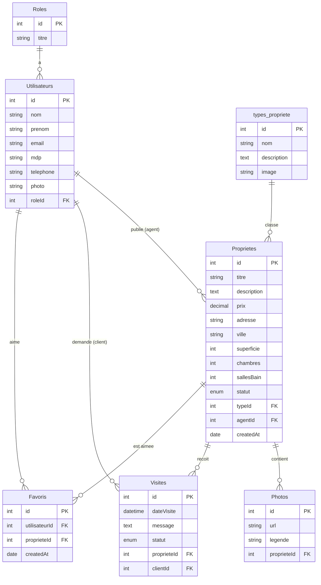

# API Immobilier 🏠

API REST d'annonces immobilières réalisée dans le cadre du cours **Introduction à la programmation de serveurs Web** (La Cité, automne 2026).

**Technologies** : Node.js, Express 5, Sequelize (MySQL), JWT, bcryptjs, express-validator, Multer, Postman.

## Équipe

| Membre | Tables |
|---|---|
| Faydi Alili | `roles`, `utilisateurs`, authentification JWT |
| _Membre 2_ | `types_propriete`, `proprietes` |
| _Membre 3_ | `photos`, `visites`, `favoris` |

## Installation

```bash
git clone https://github.com/FAYDI-DEV/api-immobilier.git
cd api-immobilier
npm install
```

1. Démarrer **MySQL** (XAMPP) et créer une base vide nommée `api_immobilier`.
2. Copier `.env.example` en `.env` et remplir les valeurs.
3. Remplir la base avec les données de départ :
   ```bash
   npm run seed
   ```
4. Lancer le serveur :
   ```bash
   npm start
   ```
   L'API tourne sur `http://localhost:5000`.

### Comptes de test (créés par `npm run seed`)

| Rôle | Email | Mot de passe |
|---|---|---|
| admin | admin@immo.ca | Password123 |
| agent | agent@immo.ca | Password123 |
| client | client@immo.ca | Password123 |

## Base de données

7 tables : `Roles`, `Utilisateurs`, `types_propriete`, `Proprietes`, `Photos`, `Visites`, `Favoris`.



Les diagrammes Lucidchart (modèle entité-associations et modèle physique) se trouvent dans le dossier [`docs/`](docs/).

## Authentification

1. `POST /api/login` avec `{ "email", "mdp" }` → renvoie un **token JWT**.
2. Envoyer le token dans l'en-tête : `Authorization: Bearer <token>`.
3. Les rôles (`admin`, `agent`, `client`) limitent l'accès à certaines routes.

## Routes

🔓 public · 🔑 connecté · 👤 rôle requis

| Méthode | Route | Accès | Description |
|---|---|---|---|
| POST | `/api/login` | 🔓 | Connexion, renvoie le token |
| **Rôles** ||||
| GET | `/api/roles` | 👤 admin | Liste |
| GET | `/api/roles/:id` | 👤 admin | Détails |
| POST | `/api/roles` | 👤 admin | Ajouter |
| PUT | `/api/roles/:id` | 👤 admin | Modifier |
| DELETE | `/api/roles/:id` | 👤 admin | Supprimer |
| GET | `/api/roles/:id/utilisateurs` | 👤 admin | Utilisateurs d'un rôle |
| **Utilisateurs** ||||
| POST | `/api/utilisateurs` | 🔓 | Inscription (form-data, fichier `photo`) |
| GET | `/api/utilisateurs?page=&limit=` | 👤 admin | Liste paginée |
| GET | `/api/utilisateurs/:id` | 🔑 soi-même ou admin | Détails |
| PUT | `/api/utilisateurs/:id` | 🔑 soi-même ou admin | Modifier (fichier `photo`) |
| DELETE | `/api/utilisateurs/:id` | 👤 admin | Supprimer |
| GET | `/api/utilisateurs/:id/annonces` | 🔓 | Annonces d'un agent |
| **Types de propriété** ||||
| GET | `/api/types?page=&limit=` | 🔓 | Liste paginée |
| GET | `/api/types/:id` | 🔓 | Détails |
| GET | `/api/types/:id/proprietes` | 🔓 | Propriétés d'un type |
| POST | `/api/types` | 👤 admin | Ajouter (fichier `image`) |
| PUT | `/api/types/:id` | 👤 admin | Modifier (fichier `image`) |
| DELETE | `/api/types/:id` | 👤 admin | Supprimer |
| **Propriétés** ||||
| GET | `/api/proprietes` | 🔓 | Liste paginée + filtres : `ville`, `prixMin`, `prixMax`, `typeId`, `statut`, `chambresMin` |
| GET | `/api/proprietes/:id` | 🔓 | Détails (type, agent, photos) |
| GET | `/api/proprietes/:id/photos` | 🔓 | Photos d'une propriété |
| POST | `/api/proprietes` | 👤 agent, admin | Ajouter (jusqu'à 10 fichiers `photos`) |
| PUT | `/api/proprietes/:id` | 👤 agent de l'annonce, admin | Modifier |
| DELETE | `/api/proprietes/:id` | 👤 agent de l'annonce, admin | Supprimer |
| **Photos** ||||
| GET | `/api/photos?proprieteId=` | 🔓 | Liste paginée |
| GET | `/api/photos/:id` | 🔓 | Détails |
| POST | `/api/photos` | 👤 agent de l'annonce, admin | Ajouter (fichier `image` + `proprieteId`) |
| PUT | `/api/photos/:id` | 👤 agent de l'annonce, admin | Modifier la légende |
| DELETE | `/api/photos/:id` | 👤 agent de l'annonce, admin | Supprimer |
| **Visites** ||||
| GET | `/api/visites` | 👤 agent (ses annonces), admin | Liste paginée |
| GET | `/api/visites/mes-visites` | 🔑 | Mes demandes de visite |
| GET | `/api/visites/:id` | 🔑 client, agent concerné, admin | Détails |
| POST | `/api/visites` | 👤 client, admin | Demander une visite |
| PUT | `/api/visites/:id/statut` | 👤 agent de l'annonce, admin | Confirmer / annuler |
| DELETE | `/api/visites/:id` | 🔑 client qui l'a demandée, admin | Supprimer |
| **Favoris** ||||
| GET | `/api/favoris` | 🔑 | Mes favoris (paginé) |
| POST | `/api/favoris` | 🔑 | Ajouter `{ proprieteId }` |
| DELETE | `/api/favoris/:proprieteId` | 🔑 | Retirer |

### Pagination

Les routes de liste acceptent `?page=1&limit=10` (100 au maximum) et renvoient :

```json
{
  "data": [ ... ],
  "pagination": { "total": 25, "page": 1, "limit": 10, "totalPages": 3 }
}
```

### Images

Les fichiers sont envoyés en **form-data** (jpg, png, webp ou gif, 5 Mo maximum), enregistrés dans `uploads/` et accessibles à `http://localhost:5000/uploads/<nom-du-fichier>`.

## Tests Postman

La collection se trouve dans [`postman/api-immobilier.postman_collection.json`](postman/).

1. Dans Postman : **Import**, puis choisir le fichier.
2. Lancer `npm run seed` puis `npm start`.
3. Exécuter d'abord le dossier **0-Login** : les tokens admin, agent et client sont enregistrés automatiquement dans les variables de la collection.
4. Pour les requêtes avec fichier (form-data), choisir une image dans le champ de type *File*.

## Structure

```
api-immobilier/
├── auth/            # login, verifyToken, autorise (roles)
├── config/          # connexion Sequelize, configuration Multer
├── controllers/     # logique de chaque table
├── models/          # modeles Sequelize + relation.js
├── routes/          # routes Express
├── validations/     # regles express-validator
├── utils/           # pagination, gestion des fichiers
├── uploads/         # images envoyees (non versionnees)
├── postman/         # collection Postman exportee
├── docs/            # diagrammes de la base de donnees
├── seed.js          # donnees de depart
└── index.js         # point d'entree
```
